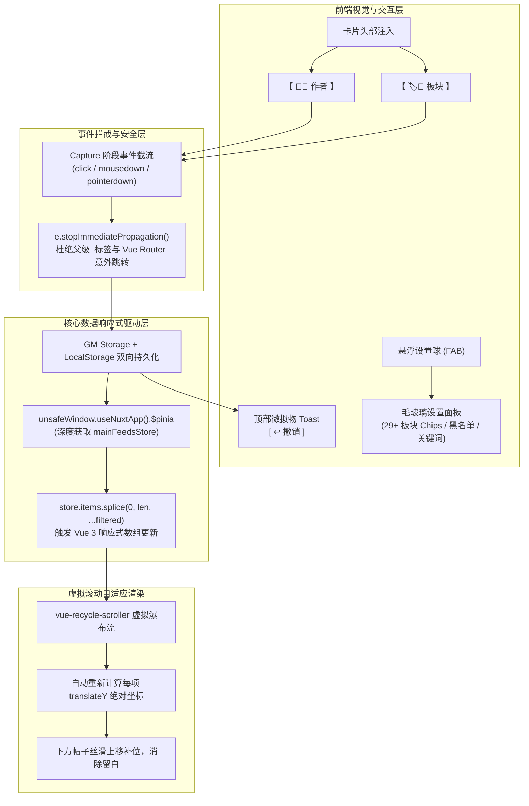

# 🛡️ QQ 频道板块与关键词屏蔽器 (QQ Guild Board & Keyword Filter)

**专为 QQ 频道网页版 (`pd.qq.com`) 打造的现代化、无缝瀑布流内容过滤与净化油猴脚本**

[🚀 一键安装脚本](https://raw.githubusercontent.com/fisherbio/qq-channel-filter/main/qq-channel-filter.user.js) · [📖 功能特性](#-核心特性) · [🛠️ 技术架构](#️-技术实现与架构亮点) · [⚙️ 使用指南](#️-使用指南) · [❓ 常见问题](#-常见问题)

---

## 💡 为什么需要这个插件？

QQ 频道网页版在“全部”、“最新”、“最热”、“热门”等聚合信息流中，会将频道下**所有不同子板块**的帖子混合展示。
- **信息噪音严重**：海量的交易二手、特定游戏开黑、打卡灌水往往刷屏，掩盖了真正有价值的讨论。
- **缺乏定向屏蔽**：官方目前未提供网页版混合流的板块过滤与指定作者拉黑功能。
- **传统隐藏插件留白痛点**：普通油猴脚本使用简单的 `display: none` 隐藏卡片，由于 QQ 频道采用 `vue-recycle-scroller` 虚拟瀑布流渲染（每个卡片高度与绝对坐标 `translateY` 均由 JS 预计算），直接隐藏会导致页面留下**巨大的突兀空白坑洞**，滑动手感极差。

**本项目深入 Nuxt 3 底层响应式状态机，实现真正 100% 紧凑无缝补位、卡片级一键屏蔽与可视化控制台！**

---

## ✨ 核心特性

### 1. ⚡ Pinia 响应式无缝排版（零空白断层）
- 深度直通 Nuxt 3 运行时底层，实时监听与响应式同步 `mainFeedsStore.items` 与 `topFeeds`。
- 触发底层 `vue-recycle-scroller` 重新计算剩余有效帖子的绝对布局坐标。
- **被屏蔽的卡片彻底移出流水线，后续帖子平滑紧凑顶上，完全不留任何空白坑洞！**

### 2. 🔄 缺额按需自动回补（Auto-Replenish & Backfill）
- **解决屏蔽后帖子总数缩减问题**：当屏蔽特定板块或用户导致当前屏幕有效帖子骤减时，内置自适应健康水位回补引擎。
- **平滑自动向后拉取**：监测到当前有效帖子低于安全保有量（`SAFE_MIN_ITEMS = 15` 条或高度不足）时，静默调用底层 `fetchFeeds()` 向后端分页获取新帖子自动补满缺额，无需用户手动反复拉扯滚动条。
- **五重边界防频控**：内置并发互斥锁、350ms 拟人阶梯防抖、单轮 3 次预算熔断、服务器到头拦截与 15 秒异常熔断冷静期，100% 杜绝死循环与频控风险。

### 2. 👤 发帖人一键拉黑（作者黑名单）
- **卡片快捷拉黑**：卡片作者昵称旁自动注入高辨识度实体胶囊按钮 `【 👤🚫 [作者名] 】`。
- **面板集中管理**：独立的用户黑名单管理抽屉，实时显示已拉黑人数，支持手动输入昵称添加或点击标签 `[×]` 一键解封。
- **无损实时回流**：一旦解除拉黑，目标作者的历史帖子毫秒级原位恢复，无需刷新页面。

### 3. 🏷️ 卡片级独立板块屏蔽
- 卡片头部自动渲染独立醒目的 `【 🏷️🚫 [板块名] 】` 胶囊按钮。
- 点击瞬间直接屏蔽该板块，无需进入设置面板翻找板块名称。

### 4. 🎯 全事件捕获级深度截流（Capture-Phase）
- QQ 频道将整张卡片包裹在 `<a class="game-guild-main__short-content">` 路由链接标签中。
- 脚本针对 `click`、`mousedown`、`mouseup`、`pointerdown` 全部启用 `{ capture: true }` 事件捕获监听，在底层 Vue Router 和 `<a>` 标签响应之前深度截流，**100% 杜绝误触跳转或点击穿透**。

### 5. 🪟 微拟物 Toast 提示与「↩️ 撤销」机制
- 彻底弃用会被 Chrome 浏览器高频静默拦截的原生 `window.confirm()` 弹窗。
- 操作延迟 < 5ms 极速响应，并在页面顶部中央滑入优雅的深色毛玻璃 Toast 浮窗。
- 若不慎手滑误触，点击 Toast 上的 `[ ↩️ 撤销 ]` 按钮即可秒级回滚。

### 6. 🔍 关键词正文与标题过滤
- 支持自定义多个关键词规则（逗号/空格分隔）。
- 实时对标题与正文执行双重正则匹配，自动剔除命中项。

### 7. 🎨 现代化玻璃拟态控制台
- 页面右下角常驻微拟物悬浮球（FAB `🛡️ 频道过滤`）。
- 展开后展示全板块可视化多选面板（支持一键全选、反选、重置），完全适配浅色/暗色主题。

---

## 🚀 安装方法

### 前置要求
请确保您的浏览器已安装主流的用户脚本管理器：
- [Tampermonkey (篡改猴)](https://www.tampermonkey.net/)（推荐）
- [Violentmonkey (暴力猴)](https://violentmonkey.github.io/)
- [ScriptCat (脚本猫)](https://docs.scriptcat.org/)

### 安装步骤
1. 点击下方链接直接安装最新版脚本：
   👉 **[点击安装 qq-channel-filter.user.js](https://raw.githubusercontent.com/fisherbio/qq-channel-filter/main/qq-channel-filter.user.js)**
2. 脚本管理器将自动弹出安装界面，点击 **“安装”** 或 **“更新”**。
3. 打开或刷新 [QQ 频道网页版](https://pd.qq.com/) 任意频道即可开始使用！

---

## 🛠️ 技术实现与架构亮点

### 1. 破解 `vue-recycle-scroller` 虚拟列表的空白痛点
现代前端长列表（如 Nuxt 3 驱动的 QQ 频道）采用虚拟列表优化性能：
- 每个卡片的外层包裹器为绝对定位：`style="transform: translateY(XXXXpx) translateX(0px);"`。
- 若仅用 CSS `display: none` 隐藏元素，Vue 的计算引擎并不知道该项已被忽略，后续卡片的 `translateY` 仍按照原有列表长度递增计算，导致被隐藏的位置留下巨大的空白间隔。
- **解决方案**：脚本在 `unsafeWindow` 的主世界执行环境中，获取 Nuxt 3 注入的 Pinia Store 实例 `mainFeedsStore`，拦截并调用响应式数组的 `splice` 方法。这样 Vue 3 能够获知数组长度变化，并自动重新触发滚动槽位重排，达成真正的 0 留白。

### 2. 原生 `window.confirm()` 静默失效的替代方案
- 现代浏览器对高频弹窗施加了严格的静默策略，旧版使用 `confirm()` 时经常直接返回 `false` 造成卡死假象。
- `v1.5.0` 全面换用非阻塞式 Toast，配合 4.5 秒倒计时和 `[ ↩️ 撤销 ]` 闭包回调，既避免了打断浏览心流，又确保了操作的绝对可逆与稳健。

---

## ⚙️ 使用指南

1. **进入聚合混合流**：进入任意频道并在顶部切换至“全部”、“最新”、“最热”或“热门”标签。
2. **快捷屏蔽板块**：在卡片作者行点击 **`🏷️🚫 [板块名]`**，该板块所有帖子即刻消失；顶部弹出 Toast，可点击 `[ ↩️ 撤销 ]` 还原。
3. **快捷拉黑作者**：在卡片作者行点击 **`👤🚫 [作者名]`**，该作者所有帖子即刻消失。
4. **个性化全局配置**：点击右下角 **`🛡️ 频道过滤`** 悬浮球：
   - 勾选或反选指定板块标签；
   - 在黑名单管理区手动添加昵称，或点击已有标签后的 `×` 解除拉黑；
   - 输入需要过滤的正文或标题关键词（多个词以逗号隔开）；
   - 点击“确定保存”即时生效。

---

## ❓ 常见问题 (FAQ)

<b>Q1: 屏蔽了某个板块后，进入该板块专区还能看帖子吗？</b>

<b>能。</b> 脚本具有智能场景感知（`isCurrentMixedFeed`）。板块过滤仅在“全部”、“热门”、“最新”等混合流中生效；当您在顶部明确点击进入该板块的独立专区时，所有过滤会自动放行，保证专区浏览不受影响。

<b>Q2: 为什么点击屏蔽后网页没有刷新，但帖子就平滑顶上去了？</b>

脚本直接对接了网页底层的 Pinia 数据响应系统，以纯数据驱动方式更新列表，无需刷新页面即可实现毫秒级丝滑补位。

<b>Q3: 如果我换了电脑或浏览器，屏蔽设置会丢失吗？</b>

脚本优先使用油猴脚本管理器的 `GM_setValue` 跨页面持久化存储，并双向备份至 `localStorage`。只要您在同一浏览器环境下，配置均会自动保留；使用支持云同步的油猴版本还可实现跨设备同步。

---

## 📄 开源许可证

本项目基于 [MIT 许可证](LICENSE) 开源。欢迎 Star、提交 Issue 或发起 Pull Request 一起完善体验！

---

Made with ❤️ by <a href="https://github.com/fisherbio">fisherbio</a>

